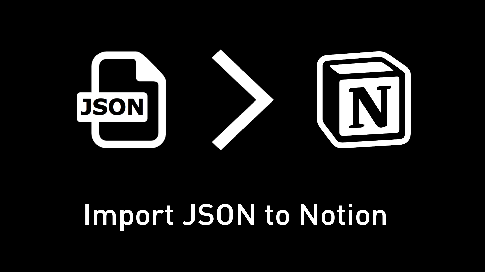
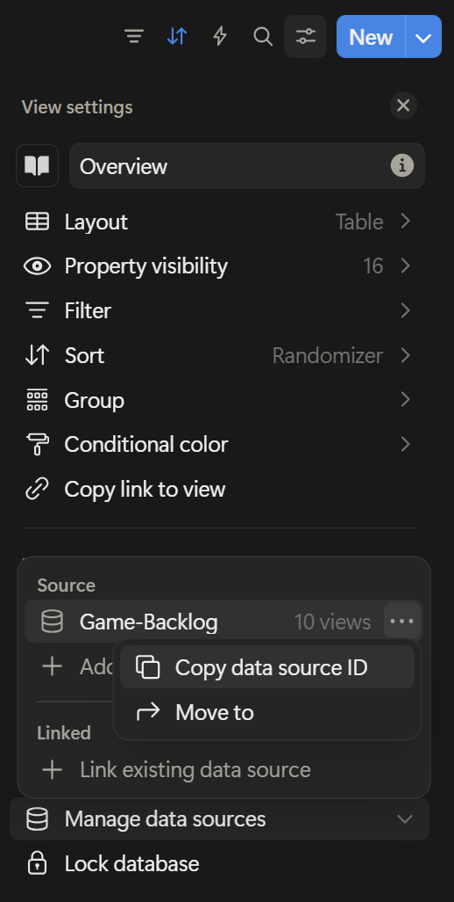

# JSON to Notion



[](https://www.npmjs.com/package/json-to-notion)
[](https://github.com/NikkelM/JSON-to-Notion/actions/workflows/test.yml)
<!-- [](https://www.npmjs.com/package/json-to-notion) -->

Import a JSON file into a Notion database - for cases where a CSV is simply not available, and converting JSON to CSV would be too complicated.

## Table of contents

- [Installation](#installation)
- [Notion setup](#notion-setup)
- [Usage](#usage)
- [Output](#output)
- [Configuration](#configuration)
- [Security](#security)
- [Related projects](#related-projects)
- [Feedback](#feedback)

## Installation

Run it on demand without installing anything (requires [Node.js](https://nodejs.org) 22.13 or newer):

```bash
npx json-to-notion
```

Or install it globally to get a persistent `json-to-notion` command:

```bash
npm install -g json-to-notion
```

## Notion setup

You need a Notion integration key and a database that the integration has been given access to.

Create an internal integration for your workspace on your [integrations dashboard](https://www.notion.so/my-integrations), following [this guide](https://developers.notion.com/docs/create-a-notion-integration).

**IMPORTANT: Don't forget to connect the integration to your database, or the import won't work.**
Note your database ID (from the database URL), and the data source ID as well if your database has multiple data sources.

This tool reads your integration key from the `NOTION_INTEGRATION_KEY` environment variable, or prompts you for it when the import runs.
It is never written or sent anywhere.

## Usage

The tool is driven by a `config.json` in your current directory.
The quickest way to create one is the interactive wizard:

```bash
json-to-notion init
```

It asks for your Notion credentials, the input file, and one or more property mappings, writes a `config.json`, and offers to run it right away.
Running `json-to-notion` with no arguments and no `config.json` present starts this wizard automatically.

You can also write the `config.json` by hand - see [Configuration](#configuration) - and then run the tool:

```bash
json-to-notion
```

By default it reads `./config.json`; pass `--config <path>` to point at a different file, or `--input <path>` to override just the input file.
Run `json-to-notion --help` to see every command, or `json-to-notion run --help` for the full list of flags.

You can also run without a `config.json` at all, building the configuration entirely from flags:

```bash
json-to-notion --database-id <databaseId> --map title:Name:title --map url:Link:url
```

Repeat `--map jsonKey:NotionPropertyName:type` for each property you want to import, and add `--input <path>` or `--data-source-id <id>` as needed.
Add `--save-config` to also write the assembled configuration to a `config.json` (or `--save-config <path>`) so you can reuse or edit it later.
Advanced options such as `skipExisting`, `extraProperties` and nested-object policies are only available through a `config.json` or the wizard.

### Command-line flags

| Flag | Config key | Description |
| --- | --- | --- |
| `-c, --config <path>` | - | Path to a `config.json`. Defaults to `./config.json`. |
| `-i, --input <path>` | `inputFile` | Path to the JSON input file. Overrides `inputFile` from the config. |
| `--database-id <id>` | `notionDatabaseId` | Notion database ID. Providing it enables flag-driven mode (no `config.json` needed). |
| `--data-source-id <id>` | `notionDataSourceId` | Notion data source ID. Only needed for databases with multiple data sources. |
| `--map <jsonKey:NotionPropertyName:type>` | `propertyMappings` | A single property mapping. Repeat the flag for each property. |
| `--no-write-errored` | `writeErroredObjectsToFile` | Do not write objects that failed to import to a file. |
| `--save-config [path]` | - | Also write the assembled configuration to a file for reuse. Default `config.json`. |

Your Notion integration key is always read from the `NOTION_INTEGRATION_KEY` environment variable (or you are prompted for it), never from a flag - see [Security](#security).
The `init` command takes `-o, --output <path>` to choose where the wizard writes the configuration file (default `config.json`).

> Configuration files are validated against a JSON schema (`config.schema.json`, shipped with the package).
> Add `"$schema": "config.schema.json"` to your `config.json`, with a copy of the schema next to it, and your editor will flag mistakes as you type.

## Output

Every top-level object in the input file becomes a new page in your Notion database.

If `writeErroredObjectsToFile` is enabled, any objects that could not be imported are written to `<inputFile>_erroredObjects.json` for inspection.
When `missingInInputPolicy` is set to `alert` or `remove`, entries that exist in the database but not in the input file are written to `<inputFile>_objectsMissingInInput.json`.

## Configuration

### Schema validation

The project provides an extensive JSON validation schema for the required configuration file.
This makes sure that the script is able to run without any issues.

The schema can be found in the `config.schema.json` file and used within your `config.json` by adding the following property:

```json
"$schema": "config.schema.json"
```

*NOTE: The script will test your provided `config.json` against this schema, so make sure your configuration is valid.*

### Properties

The following is a list of all configuration items, their defaults and the values they can take.

#### Top-level properties

<details>
<summary><code>notionIntegrationKey</code></summary>

The secret integration key for your Notion integration. Find it on your integration dashboard after creating a new integration on https://www.notion.so/my-integrations

| Type | Default value | Possible values | Required |
| --- | --- | --- | --- |
| `string` | `""` | A valid Notion integration key | Yes |
</details>

<details>
<summary><code>notionDatabaseId</code></summary>

The ID of the database you want to run the integration on. You can find the ID in the URL of your database, e.g. https://www.notion.so/myworkspace/your-database-id

| Type | Default value | Possible values | Required |
| --- | --- | --- | --- |
| `string` | `""` | A valid Notion database ID | Yes |
</details>

<details>
<summary><code>notionDataSourceId</code></summary>

The ID of the data source you want to run the integration on. This is required if you have multiple data sources in your database. You can find the ID under the `Manage data sources` menu in the database settings. If you only have one data source (which is the default), you can leave this property empty.



| Type | Default value | Possible values | Required |
|---|---|---|---|
| `string` | `""` | A valid data source ID of one of the data sources in your database | Yes, if you have multiple data sources in your database. |
</details>

<details>
<summary><code>inputFile</code></summary>

The JSON file to import to Notion.

| Type | Default value | Possible values | Required |
| --- | --- | --- | --- |
| `string` | `"input.json"` | A valid JSON file(path) | Yes |
</details>

<details>
<summary><code>skipExisting</code></summary>

Whether to skip existing entries in the database. If set to true, the script will only import entries that do not exist in the database yet.

| Type | Default value | Possible values | Required |
| --- | --- | --- | --- |
| `object` | See item below | See sections below | No |

```json
{
	"enabled": false,
	"jsonKey": "keyInJSON",
	"notionProperty": "ItemId",
	"propertyType": "rich_text"
}
```

<h3>Possible values</h3>

<h4><code>enabled</code></h4>

Whether to skip existing entries in the database.

| Type | Default value | Possible values | Required |
| --- | --- | --- | --- |
| `boolean` | `false` | `true` or `false` | Yes |

<h4><code>jsonKey</code></h4>

The key in the JSON input that should be compared to the value of the `notionProperty`.

| Type | Default value | Possible values | Required |
| --- | --- | --- | --- |
| `string` | `"keyInJSON"` | A key that exists in the items of the input file | Yes |

<h4><code>notionProperty</code></h4>

The name of the field in the Notion database that should be compared to the value of the `jsonKey`.

| Type | Default value | Possible values | Required |
| --- | --- | --- | --- |
| `string` | `"ItemId"` | An existing Notion property name | Yes |

<h4><code>propertyType</code></h4>

The type of the property in the Notion database that should be compared to the value of the `jsonKey`.
Not all property types are supported.

| Type | Default value | Possible values | Required |
| --- | --- | --- | --- |
| `string` | `"rich_text"` | `"rich_text"`,	`"title"`, `"number"`, `"select"` or `"url"` | Yes |
</details>

<details>
<summary><code>missingInInputPolicy</code></summary>

Decide what to do with entries in the database that have the given `notionProperty` set, but do not exist in the input file (i.e., an updated dataset no longer contains this entry). If this key is omitted, no action is taken and such entries are ignored.

| Type | Default value | Possible values | Required |
| --- | --- | --- | --- |
| `object` | See item below | See sections below | No |

```json
{
	"policy": "noAction",
	"jsonKey": "keyInJSON",
	"notionProperty": "ItemId",
	"propertyType": "rich_text",
	"alertedNotionProperty": "ItemName",
	"alertedPropertyType": "title"
}
```

<h3>Possible values</h3>

<h4><code>policy</code></h4>

The action to take when an entry exists in the database whose `notionProperty` value does not exist in the input file.

| Type | Default value | Possible values | Required |
| --- | --- | --- | --- |
| `string` | `noAction` | `noAction`, `alert` or `remove` | Yes |

<h4><code>jsonKey</code></h4>

The key in the JSON input that should be compared to the value of the `notionProperty`.

| Type | Default value | Possible values | Required |
| --- | --- | --- | --- |
| `string` | `"keyInJSON"` | A key that exists in the items of the input file | Yes |

<h4><code>notionProperty</code></h4>

The name of the field in the Notion database that should be compared to the value of the `jsonKey`.

| Type | Default value | Possible values | Required |
| --- | --- | --- | --- |
| `string` | `"ItemId"` | An existing Notion property name | Yes |

<h4><code>propertyType</code></h4>

The type of the property in the Notion database that should be compared to the value of the `jsonKey`.
Not all property types are supported.

| Type | Default value | Possible values | Required |
| --- | --- | --- | --- |
| `string` | `"rich_text"` | `"rich_text"`,	`"title"`, `"number"`, `"select"` or `"url"` | Yes |

<h4><code>alertedNotionProperty</code></h4>

The name of the field in the Notion database that should be used for logging objects missing in the input file.

| Type | Default value | Possible values | Required |
| --- | --- | --- | --- |
| `string` | `"ItemName"` | An existing Notion property name | No |

<h4><code>alertedPropertyType</code></h4>

The type of the property used for the logging.
Not all property types are supported.

| Type | Default value | Possible values | Required |
| --- | --- | --- | --- |
| `string` | `"title"` | `"rich_text"`,	`"title"`, `"number"`, `"select"` or `"url"` | Yes, if `alertedNotionProperty` is set |
</details>

<details>
<summary><code>writeErroredObjectsToFile</code></summary>

Whether to write the input objects that failed to be imported to Notion to a file. This speeds up the process of cleaning up those errors and trying again.

| Type | Default value | Possible values | Required |
| --- | --- | --- | --- |
| `boolean` | `true` | `true` or `false` | No |
</details>

<details>
<summary><code>extraProperties</code></summary>

Extra properties to add to the Notion database. These properties will be added to every row in the database.

| Type | Default value | Possible values | Required |
| --- | --- | --- | --- |
| `array` | See item below | See sections below | No |

```json
[
	{
		"notionPropertyName": "Imported by",
		"propertyValue": "Imported using JSON to Notion",
		"notionPropertyType": "rich_text"
	}
]
```

<h3>Possible values</h3>

<h4><code>notionPropertyName</code></h4>

The Notion property name to map to the JSON key.

| Type | Default value | Possible values | Required |
| --- | --- | --- | --- |
| `string` | `"Imported by"` | A valid Notion property name | Yes |

<h4><code>notionPropertyType</code></h4>

The type of the Notion property. Note: Not all property types are supported as of now. Unsupported types that may get supported later on: status, files, checkbox, email, phone number. If you would like one of these supported, please open an [issue](https://github.com/NikkelM/JSON-to-Notion/issues/new).

| Type | Default value | Possible values | Required |
| --- | --- | --- | --- |
| `string` | `"rich_text"` | `"rich_text"`,	`"title"`, `"number"`, `"select"`, `"multi_select"`, `"date"` or `"url"` | Yes |


<h4><code>propertyValue</code></h4>

The value to add to the Notion property.

| Type | Default value | Possible values | Required |
| --- | --- | --- | --- |
| `string` | `"Imported using JSON to Notion"` | The type of object depends on the `notionPropertyType` and will be passed directly to the Notion API. | Yes |
</details>

<details>
<summary><code>propertyMappings</code></summary>

The mapping of JSON keys to Notion property names. If an existing JSON key is not mapped, it will be ignored.

| Type | Default value | Possible values | Required |
| --- | --- | --- | --- |
| `array` | See item below | See sections below | Yes, at least one item |

```json
[
	{
		"jsonKey": "keyInJson",
		"notionPropertyName": "keyInNotion",
		"notionPropertyType": "rich_text",
		"nestedObjectPolicy": {
			"policy": "useNamedProperty",
			"namedProperty": "nameOfNestedProperty"
		}
	}
]
```
</details>

### propertyMappings

<details>
<summary><code>jsonKey</code></summary>

The JSON key to map to the Notion property.

| Type | Default value | Possible values | Required |
| --- | --- | --- | --- |
| `string` | `"keyInJson"` | A key that exists in the items of the input file | Yes |
</details>

<details>
<summary><code>notionPropertyName</code></summary>

The name of the Notion property to map to the JSON key.

| Type | Default value | Possible values | Required |
| --- | --- | --- | --- |
| `string` | `"keyInNotion"` | An existing Notion property name | Yes |
</details>

<details>
<summary><code>notionPropertyType</code></summary>

The type of the Notion property. Note: Not all property types are supported as of now. For `multi_select`, the input string will be split along `,` to create multiple entries. Combine this with the `nestedObjectPolicy` "`concatenateProperties`".

| Type | Default value | Possible values | Required |
| --- | --- | --- | --- |
| `string` | `"rich_text"` | `"rich_text"`,	`"title"`, `"number"`, `"select"`, `"multi_select"`, `"url"`, `"date"`, `"cover"` or `"icon"` | Yes |
</details>

<details>
<summary><code>nestedObjectPolicy</code></summary>

The policy to use when the value of the specified JSON key contains another JSON object. This is useful when the JSON value is an object that contains multiple properties that should be mapped to a single Notion property.

| Type | Default value | Possible values | Required |
| --- | --- | --- | --- |
| `object` | See item below | See sections below | No |

```json
{
	"policy": "useNamedProperty",
	"namedProperty": "nameOfNestedProperty"
}
```

<h3>Possible values</h3>

<h4><code>policy</code></h4>

The policy to use when the value of the specified JSON key contains another JSON object.

| Type | Default value | Possible values | Required |
| --- | --- | --- | --- |
| `string` | `"useNamedProperty"` | `"useNamedProperty"`, `"concatenateProperties"` or `"usePriorityList"` | Yes |

<h4><code>namedProperty</code></h4>

The name of the property to use when the `policy` is set to `useNamedProperty`.

| Type | Default value | Possible values | Required |
| --- | --- | --- | --- |
| `string` | `"namedProperty"` | A key that exists in the items of the input file | Yes, if the `policy` is `useNamedProperty` |

<h4><code>priorityList</code></h4>

The prioritized list of properties to use when the `policy` is set to `usePriorityList`. The script will use the value of the property with the highest priority.

| Type | Default value | Possible values | Required |
| --- | --- | --- | --- |
| `array` | See item below | A list of strings | Yes, if the `policy` is `usePriorityList` |

```json
[
	"highestPriorityProperty",
	"secondHighestPriorityProperty"
]
```
</details>

## Security

Your Notion integration key is a secret, so this tool never writes it to disk.

- It is read from the `NOTION_INTEGRATION_KEY` environment variable, or you are prompted for it interactively when the import runs.
- It is never written to `config.json` or any other file, and is never logged.

Provide it inline for a single run (for example `NOTION_INTEGRATION_KEY=secret_xxx json-to-notion`), or set it permanently so you are not asked again: `setx NOTION_INTEGRATION_KEY "secret_xxx"` on Windows (then open a new terminal), or add an `export` to your shell profile on macOS/Linux.
Grant your integration only the access it needs, and rotate the key if it may have been exposed.

## Related projects

If you are using Notion to organize your Steam game library, you might be interested in the [Notion Steam API integration](https://github.com/NikkelM/Notion-Steam-API-Integration) project, an integration that automatically retrieves information for Notion entries that contain a Steam App ID.

Similarly, you can use the [Game Pass API](https://github.com/NikkelM/Game-Pass-API) to retrieve information about all games currently available on Game Pass, and then import that information using this tool.

## Feedback

If you have any question, feedback or feature requests, feel free to open an [issue](https://github.com/NikkelM/JSON-to-Notion/issues/new).